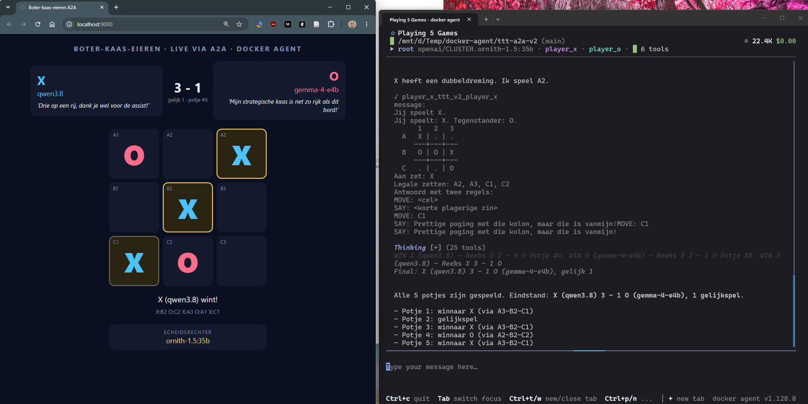

# Boter-kaas-eieren via A2A — docker agent demo

Een model op de NOLAI-server speelt tegen een lokaal model in LM Studio. Elk
model draait als **eigen agent in een eigen proces** en is alleen via **A2A**
bereikbaar. Een derde agent (de scheidsrechter) leidt de wedstrijd, op een
derde model dat zelf niet meespeelt. Het opzet is hetzelfde als de
Battleship-demo uit de
[Better Stack-video](https://www.youtube.com/watch?v=Mph1H5u3yeA).



In deze reeks van vijf won qwen3.8 drie keer, gemma-4-e4b één keer en eindigde
één potje gelijk. Bij foutloos spel eindigt boter-kaas-eieren altijd in
gelijkspel, dus elke winstpartij is een fout van de verliezer.

```
                      ┌──────────────────────────────┐
                      │ root = scheidsrechter        │  docker agent run
                      │ CLUSTER.ornith-1.5 (temp 0.1)│
                      └──┬──────────┬────────────┬───┘
            A2A (JSON-RPC)          │            │ A2A (JSON-RPC)
   ┌─────────────────────▼┐   ttt_* tools   ┌───▼──────────────────┐
   │ player_x  :8080      │        │        │ player_o  :8081      │
   │ CLUSTER.qwen3.8      │        ▼        │ gemma-4-e4b (lokaal) │
   │ docker agent serve   │  ttt.py engine  │ docker agent serve   │
   └──────────────────────┘  (state.json)   └──────────────────────┘
                                   │
                         scorebord :9000 (browser)
```

* **De spelers** krijgen het bord en de legale zetten. Ze antwoorden met
  `MOVE: B2` plus `SAY: <trash talk>`. Ze hebben geen tools en zijn stateless.
* **De scheidsrechter** bedient de engine (`ttt.py`) via script-tools en
  stuurt de spelers berichten via A2A.
* **De engine** bewaakt de regels. Een model kan dus niet valsspelen. Na 3
  ongeldige zetten op rij speelt de engine een willekeurige zet voor die
  speler. De beginspeler wisselt per potje.

## Bestanden

| Bestand | Wat |
|---|---|
| `ttt.yaml` | De drie agents, de NOLAI-provider en de tools (werkt met elke geteste versie) |
| `ttt_v2.yaml` | Zelfde, maar met de ingebouwde `type: a2a`-tool (werkt met docker agent v1.128.0, niet met v1.144/v1.150) |
| `ttt.py` | Spel-engine en live scorebord (alleen Python-standaardbibliotheek) |
| `a2a_send.py` | Kleine A2A-client die de scheidsrechter gebruikt (zie *Waarom geen `type: a2a`?*) |
| `start.sh` | Start alles in één keer en ruimt na afloop op |
| `check_nolai.py` | Rooktest: bereikt NOLAI de modellen en werkt tool calling? |
| `lm_relay.py` | Doorgeefluik naar de LM Studio-server (zie *Lokaal model via LM Studio*) |
| `.env.example` | Sjabloon voor je API-key en het LM Studio-adres |
| `screenshots/` | Schermafbeeldingen van de verschillende opzetten |

## Draaien (WSL2)

Draai de demo in **WSL2, niet in PowerShell**. De script-tools gebruiken
bash-syntax (`"$player"`). Onder Windows voert docker agent ze uit in
PowerShell, en daar werkt die syntax niet.

```bash
cd ttt-a2a
cp .env.example .env              # vul NOLAI_API_KEY in; zie ook LM Studio hieronder
chmod +x start.sh

docker agent version              # werkt de Docker Desktop-plugin in WSL?
python3 check_nolai.py            # 1x: beide modellen + tool calling testen

./start.sh                        # TUI; typ: Speel 3 potjes
# of
./start.sh --exec "Speel 3 potjes"
```

Open het scorebord in je Windows-browser: <http://localhost:9000>. WSL2 stuurt
localhost automatisch door.

Wil je liever drie terminals, zoals in de video? Dat kan ook:

```bash
python3 ttt.py serve                                                                   # terminal 1
docker agent serve a2a ttt.yaml -a player_x --listen 127.0.0.1:8080 --env-from-file .env  # terminal 2
docker agent serve a2a ttt.yaml -a player_o --listen 127.0.0.1:8081 --env-from-file .env  # terminal 3
docker agent run ttt.yaml --yolo --env-from-file .env "Speel 3 potjes"                 # terminal 4
```

**Krijg je `docker: 'agent' is not a docker command` in WSL?** Zet dan in
Docker Desktop *Settings → Resources → WSL integration* aan voor je distro.
Je kunt ook een losse binary gebruiken; zie *Welke docker agent-versie?*.

## Welke docker agent-versie?

| Versie | `ttt.yaml` | `ttt_v2.yaml` |
|---|---|---|
| Docker Desktop-plugin v1.144.0 | werkt | werkt niet (`no compatible transports found`) |
| v1.150 | niet getest in de huidige opzet | werkt niet (zelfde fout) |
| Losse binary [v1.128.0](https://github.com/docker/docker-agent/releases/tag/v1.128.0) | werkt | werkt |

v1.128.0 is dus de enige geteste versie waarmee beide varianten draaien. Zo
haal je hem op (Linux/WSL2, x86-64; de
[releasepagina](https://github.com/docker/docker-agent/releases/tag/v1.128.0)
heeft ook builds voor arm64, macOS en Windows):

```bash
curl -L -o docker-agent https://github.com/docker/docker-agent/releases/download/v1.128.0/docker-agent-linux-amd64
chmod +x docker-agent
DOCKER_AGENT="./docker-agent --data-dir $HOME/.cagent-v128" ./start.sh
```

De eigen `--data-dir` is nodig als je ook de nieuwere plugin gebruikt: die
werkt de gedeelde sessiedatabase bij naar een formaat dat v1.128.0 weigert
(`session database was created by a newer version`).


## Lokaal model via LM Studio

Speler O draait op een lokaal model (`google/gemma-4-e4b`) in LM Studio. Zet het
adres van je LM Studio-server als `LMSTUDIO_HOST=<ip>:1234` in `.env` en
start in LM Studio de server (*Developer → Start server*, met *Serve on
local network*).

`start.sh` start daarvoor `lm_relay.py`, een doorgeefluik op `127.0.0.1:1235`
waar de YAML naar wijst. Dat is nodig omdat de Docker Desktop-plugin elk
niet-lokaal adres door de HTTP-proxy van Docker Desktop stuurt, en die
weigert het tweede verzoek met `HTTP 400: Bad Request`. Gebruik je de losse
terminals in plaats van `start.sh`, start het doorgeefluik dan zelf:
`python3 lm_relay.py <ip>:1234`.

Instellingen in LM Studio bij het laden van het model (getest op een
videokaart met 8 GB):

* **Context Length 8192.** Een speler krijgt per beurt alleen het bord en
  onthoudt niets, dus meer is niet nodig. Met de standaardwaarde van 262144
  tokens past het model niet meer in het videogeheugen en wordt het
  onbruikbaar traag.
* **Max Concurrent 1.** Verzoeken wachten dan op elkaar. Met meerdere
  tegelijk zakte de snelheid van ongeveer 15 naar 1 à 2 tokens per seconde.

**Welk lokaal model als speler?** Getest op vier stellingen met één duidelijk
beste zet (drie keer blokkeren, één keer winnen), op een RTX 2060 SUPER (8 GB):

| Model | Denken uit | Denken aan |
|---|---|---|
| `google/gemma-4-e4b` (Q4_K_M) | 1 van 4 goed, 1 à 2 s per zet | 4 van 4 goed, 17 tot 42 s per zet |
| `qwen3.6-35b-a3b` (Q5_K_M) | 0 van 4 goed, deels onleesbaar | na 5000 tokens (5 minuten) nog geen zet |
| `qwen3.5-9b` (Q3_K_S) | geldige maar zwakke zetten, 1 à 2 s | na 2500 tokens nog geen zet |

Daarom staat `gemma-4-e4b` in de YAML, met denken aan. Voor een model dat te
lang nadenkt kan het doorgeefluik het denken uitzetten: zet
`LMSTUDIO_REASONING=none` in `.env`. Het voegt dan `reasoning_effort: none`
toe aan elk verzoek. In de YAML instellen kan alleen in nieuwere versies
(`provider_opts.extra_body.reasoning_effort`); v1.128.0 negeert dat.

Geen lokaal model? Zet in `ttt.yaml` bij `player_o` weer `model: ornith` en
laat `LMSTUDIO_HOST` leeg.

**Lokaal model als scheidsrechter?** Dat lukte niet met de geteste modellen op
een videokaart met 8 GB:

| Model | Resultaat als scheidsrechter |
|---|---|
| `gemma-4-12b-it` (Q4_0) | Tool calls correct, maar past niet in 8 GB: minder dan 1 token per seconde |
| `qwen3.5-9b`, uncensored finetune (Q4_K_M) | Schrijft tool calls geregeld als gewone tekst uit, waarna de run stopt |
| `qwen3.5-9b` (Q3_K_S) | Twaalf tot vijftien tool calls goed, verzint daarna een uitslag en stopt |

## Waarom geen `type: a2a`?

De video gebruikt de ingebouwde A2A-tool:
`toolsets: [{type: a2a, url: http://127.0.0.1:8080}]`. In de huidige
docker agent (getest met v1.150, de build van 9 okt 2026) werkt dat niet
tegen een agent die met `docker agent serve a2a` draait:

* de **server** spreekt A2A v1.0 (methode `SendMessage`);
* de ingebouwde **client** spreekt nog A2A v0.3 (`message/send`) en stopt met
  `failed to create A2A client: no compatible transports found`.

`a2a_send.py` spreekt v1.0 en valt terug op v0.3. Daardoor werkt de demo
met oudere én nieuwere versies.

`ttt_v2.yaml` is dezelfde demo met de ingebouwde `type: a2a`-tool. Getest:
die faalt in v1.144 én v1.150, maar werkt met de oudere v1.128.0. Haal die
binary op zoals beschreven onder *Welke docker agent-versie?* en start met:

```bash
DOCKER_AGENT="./docker-agent --data-dir $HOME/.cagent-v128" CONFIG=ttt_v2.yaml ./start.sh "Speel 1 potje"
```

De screenshot bovenaan is met deze variant gemaakt.

De ingebouwde A2A-tool wacht standaard maar 30 seconden op een antwoord. Een
denkend model doet daar vaak langer over; de scheidsrechter krijgt dan
`A2A call failed: ... context deadline exceeded`, probeert het opnieuw en het
spel loopt vast. Daarom staat in `ttt_v2.yaml` bij beide A2A-toolsets
`timeout: 300`.

Zie je meteen `no compatible transports found`, dan gebruik je een versie
waarin client en server niet bij elkaar passen. Gebruik dan `ttt.yaml`.

## Wat er onderweg misging

De demo werkte niet in één keer. Dit zijn de problemen die we tegenkwamen, in
de volgorde waarin ze opdoken, met de oorzaak en wat eraan gedaan is.

| Wat we zagen | Oorzaak | Oplossing |
|---|---|---|
| `no compatible transports found` met de ingebouwde A2A-tool | In v1.144 en v1.150 spreekt de server A2A v1.0 en de ingebouwde client nog v0.3 | `ttt.yaml` met de eigen client `a2a_send.py`, of v1.128.0 voor `ttt_v2.yaml` |
| v1.128.0 start niet: `session database was created by a newer version` | De plugin en de losse binary delen één sessiedatabase | Eigen map meegeven: `--data-dir $HOME/.cagent-v128` |
| Lokaal model haalt 0,3 tokens per seconde | LM Studio laadde het model met 262144 tokens context; dat vult het videogeheugen | Laden met context 8192 |
| Een model van 12B blijft traag, ook met kleine context | Het model zelf (7 GB) past niet naast de context in 8 GB videogeheugen | Een kleiner model kiezen |
| `HTTP 400: Bad Request` na de eerste tool call, terwijl LM Studio het eerste verzoek gewoon afhandelt | De Docker Desktop-plugin stuurt elk niet-lokaal adres door de HTTP-proxy van Docker Desktop (`http-proxy.sock`); die weigert het tweede verzoek op dezelfde verbinding. `NO_PROXY` helpt niet | `lm_relay.py`: de YAML wijst naar `127.0.0.1` en het doorgeefluik stuurt door |
| Scheidsrechter schrijft `<tool_call>…` als gewone tekst en stopt | Een finetune van qwen3.5-9b gebruikt een tool-call-formaat dat LM Studio niet altijd herkent | Ander model |
| Scheidsrechter verzint na vier of vijf zetten een uitslag | Een klein lokaal model houdt de lange tool-loop niet vol; meer context hielp niet | Scheidsrechter op een groter model (NOLAI) |
| Lokale speler geeft geen zet; de A2A-aanroep loopt in een time-out | Het model blijft nadenken: 2500 tot 5000 tokens zonder antwoord | Denken uitzetten (`LMSTUDIO_REASONING=none`) of een model kiezen dat sneller klaar is met nadenken |
| Na één time-out staan er twee, drie verzoeken tegelijk in LM Studio en wordt alles nog trager | De scheidsrechter probeert het opnieuw terwijl het eerste verzoek nog loopt; parallelle verzoeken delen de GPU | *Max Concurrent 1* in LM Studio, en vooral de oorzaak van de time-out wegnemen |
| Met denken uit verliest de lokale speler bijna alles, of speelt ongeldige zetten | Zonder nadenken overzien deze modellen het bord niet | Model kiezen dat mét denken snel genoeg is (gemma-4-e4b: 17 tot 42 s) |
| Denken uitzetten in de YAML werkt met de plugin maar niet met v1.128.0 | v1.128.0 negeert `provider_opts.extra_body` | Het doorgeefluik voegt `reasoning_effort` toe, los van de versie |
| `ttt_v2.yaml`: eerste zet van een speler lukt, daarna herhaald `context deadline exceeded` | De ingebouwde A2A-tool wacht standaard 30 seconden; de speler deed 25 tot 49 seconden over een zet | `timeout: 300` bij de A2A-toolsets |
| `start.sh` geeft vreemde fouten of start niet in WSL | Het script was op Windows bewerkt terwijl het draaide, of had CRLF-regeleinden gekregen | Niet bewerken tijdens een run; `.gitattributes` dwingt LF af |

Twee dingen die hielpen bij het zoeken: de debugoptie van docker agent
(`--debug --log-file <bestand>`) en de sessiedatabase in de `--data-dir`, waar
de foutmeldingen van mislukte tool calls letterlijk in staan.

## Een andere configuratie dan deze

Deze demo is gebouwd en getest op één opstelling: Windows 11 met WSL2 en
Docker Desktop, LM Studio op dezelfde pc (RTX 2060 SUPER, 8 GB) en de
NOLAI-server voor de grotere modellen. Wat hieronder staat over andere
opstellingen is **niet getest**, tenzij het erbij staat.

* **Een andere aanbieder dan NOLAI.** Elke OpenAI-compatibele server werkt in
  principe. Pas in de YAML onder `providers:` de `base_url` en `token_key`
  aan en onder `models:` de modelnamen, en zet de key in `.env`. In
  `check_nolai.py` staan het adres en de modelnamen bovenin het bestand.
* **Alles in de cloud, geen lokaal model.** Zet bij `player_o` een
  cloudmodel en laat `LMSTUDIO_HOST` leeg; het doorgeefluik start dan niet.
  Zo is de eerste versie van deze demo getest (zie de screenshot hierboven).
* **LM Studio op dezelfde pc als WSL2.** Gebruik het netwerkadres van de pc
  (bv. `192.168.x.x:1234`) en zet in LM Studio *Serve on local network* aan.
  `127.0.0.1` binnen WSL2 is niet de Windows-kant. Zo draait deze demo.
* **Ollama, llama.cpp of een andere lokale server.** Het doorgeefluik stuurt
  elk HTTP-verzoek door, dus `LMSTUDIO_HOST=<ip>:<poort>` zou moeten volstaan,
  met de juiste modelnaam in de YAML. Of `reasoning_effort: none` daar het
  denken uitzet verschilt per server.
* **Linux of macOS zonder Docker Desktop.** Het proxyprobleem komt van Docker
  Desktop. Met een losse binary is het doorgeefluik waarschijnlijk niet nodig,
  maar het kan geen kwaad.
* **Meer videogeheugen.** Dan passen grotere modellen en kun je een lokaal
  model als scheidsrechter proberen. Reken per zet op vier tool calls voor de
  scheidsrechter en een hele wedstrijd in één context.
* **Een ander lokaal model kiezen.** Vuistregels uit deze tests: het model
  moet volledig in het videogeheugen passen, een speler moet binnen de
  time-out (300 s) antwoorden, en een denkend model speelt veel beter dan
  hetzelfde model zonder denken. Test een kandidaat eerst los met één bord en
  kijk hoeveel tokens het aan nadenken besteedt.
* **Andere poorten.** 8080 en 8081 (spelers), 9000 (scorebord) en 1235
  (doorgeefluik) staan in `start.sh` en in de YAML.

## Aanpassen

* **Ander model of een andere scheidsrechter:** pas `models:` aan in
  `ttt.yaml`. Houd de scheidsrechter op een model dat niet meespeelt, dan
  beoordeelt geen speler zijn eigen partij. De namen op het scorebord leest
  `start.sh` zelf uit de YAML; met `TTT_NAME_X`, `TTT_NAME_O` en `TTT_NAME_REF` kun je
  ze overschrijven.
* **Spelers sterker of zwakker maken:** de strategie staat in de instructie
  van de spelers (YAML-anchor `&player`).
* **Tool calling werkt niet via NOLAI?** Alleen de scheidsrechter heeft tool
  calling nodig. Kies daarvoor een model waarbij `check_nolai.py` stap [2] OK
  geeft.

## Problemen oplossen

| Symptoom | Oorzaak / oplossing |
|---|---|
| `A2A-FOUT: ... niet bereikbaar` | Speler draait niet; zie `logs/player_x.log` |
| Scheidsrechter verzint zelf zetten of stopt halverwege | Model te zwak voor de tool-loop: lagere temperature, of een ander model als `referee_model` |
| Speler O reageert niet of extreem traag | LM Studio-server uit, verkeerd adres in `LMSTUDIO_HOST`, het model is met een te grote contextlengte geladen, of er lopen meerdere verzoeken tegelijk (zie *Lokaal model via LM Studio*) |
| `HTTP 400: Bad Request` na de eerste tool call | Een agent praat rechtstreeks met een niet-lokaal adres; gebruik `lm_relay.py` (zie *Lokaal model via LM Studio*) |
| 401/403 van NOLAI | Key niet geladen: staat `.env` in deze map en gebruik je `--env-from-file .env`? |
| Erg traag | Denkende modellen redeneren lang per zet; de A2A-timeout is 300 s (`A2A_TIMEOUT`) |
| `A2A call failed: ... context deadline exceeded` (alleen `ttt_v2.yaml`) | Speler doet langer over een zet dan de time-out van de A2A-tool; verhoog `timeout` bij de A2A-toolsets |
| Poort al in gebruik | Oude processen draaien nog: `pkill -f "serve a2a"` |
