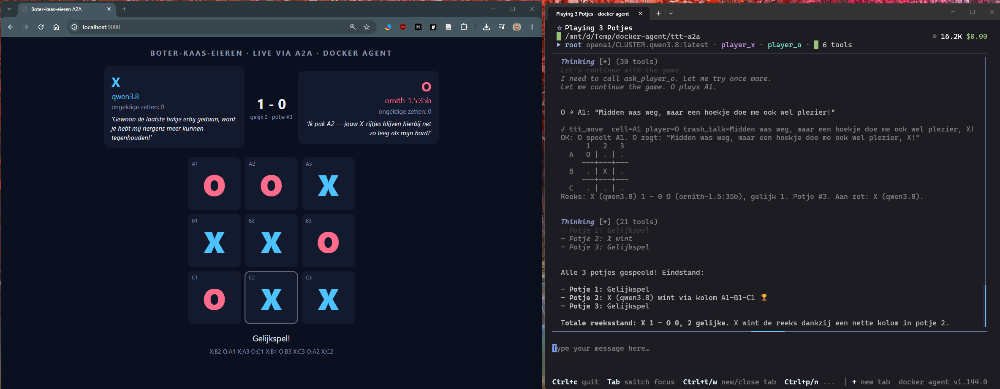
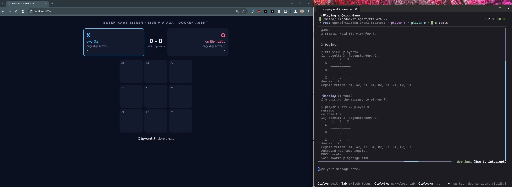

# Boter-kaas-eieren via A2A — docker agent demo

Een model op de NOLAI-server speelt tegen een lokaal model in LM Studio. Elk
model draait als **eigen agent in een eigen proces** en is alleen via **A2A**
bereikbaar. Een derde agent (de scheidsrechter) leidt de wedstrijd, op een
derde model dat zelf niet meespeelt. Het opzet is hetzelfde als de
Battleship-demo uit de
[Better Stack-video](https://www.youtube.com/watch?v=Mph1H5u3yeA).



```
                      ┌──────────────────────────────┐
                      │ root = scheidsrechter        │  docker agent run
                      │ CLUSTER.ornith-1.5 (temp 0.1)│
                      └──┬──────────┬────────────┬───┘
            A2A (JSON-RPC)          │            │ A2A (JSON-RPC)
   ┌─────────────────────▼┐   ttt_* tools   ┌───▼──────────────────┐
   │ player_x  :8080      │        │        │ player_o  :8081      │
   │ CLUSTER.qwen3.8      │        ▼        │ qwen3.5-9b (lokaal)  │
   │ docker agent serve   │  ttt.py engine  │ docker agent serve   │
   └──────────────────────┘  (state.json)   └──────────────────────┘
                                   │
                         scorebord :9000 (browser)
```

* **De spelers** krijgen het bord en de legale zetten. Ze antwoorden met
  `MOVE: B2` plus `SAY: <trash talk>`. Ze hebben geen tools en zijn stateless.
* **De scheidsrechter** bedient de engine (`ttt.py`) via script-tools en
  stuurt de spelers berichten via A2A.
* **De engine** bewaakt de regels. Een model kan dus niet valsspelen. Na 3
  ongeldige zetten op rij speelt de engine een willekeurige zet voor die
  speler. De beginspeler wisselt per potje.

## Bestanden

| Bestand | Wat |
|---|---|
| `ttt.yaml` | De drie agents, de NOLAI-provider en de tools (werkt met elke geteste versie) |
| `ttt_v2.yaml` | Zelfde, maar met de ingebouwde `type: a2a`-tool (werkt met docker agent v1.128.0, niet met v1.144/v1.150) |
| `ttt.py` | Spel-engine en live scorebord (alleen Python-standaardbibliotheek) |
| `a2a_send.py` | Kleine A2A-client die de scheidsrechter gebruikt (zie *Waarom geen `type: a2a`?*) |
| `start.sh` | Start alles in één keer en ruimt na afloop op |
| `check_nolai.py` | Rooktest: bereikt NOLAI de modellen en werkt tool calling? |
| `lm_relay.py` | Doorgeefluik naar de LM Studio-server (zie *Lokaal model via LM Studio*) |
| `.env.example` | Sjabloon voor je API-key en het LM Studio-adres |
| `screenshots/` | Schermafbeeldingen van beide varianten |

## Draaien (WSL2)

Draai de demo in **WSL2, niet in PowerShell**. De script-tools gebruiken
bash-syntax (`"$player"`). Onder Windows voert docker agent ze uit in
PowerShell, en daar werkt die syntax niet.

```bash
cd ttt-a2a
cp .env.example .env              # vul NOLAI_API_KEY in; zie ook LM Studio hieronder
chmod +x start.sh

docker agent version              # werkt de Docker Desktop-plugin in WSL?
python3 check_nolai.py            # 1x: beide modellen + tool calling testen

./start.sh                        # TUI; typ: Speel 3 potjes
# of
./start.sh --exec "Speel 3 potjes"
```

Open het scorebord in je Windows-browser: <http://localhost:9000>. WSL2 stuurt
localhost automatisch door.

Wil je liever drie terminals, zoals in de video? Dat kan ook:

```bash
python3 ttt.py serve                                                                   # terminal 1
docker agent serve a2a ttt.yaml -a player_x --listen 127.0.0.1:8080 --env-from-file .env  # terminal 2
docker agent serve a2a ttt.yaml -a player_o --listen 127.0.0.1:8081 --env-from-file .env  # terminal 3
docker agent run ttt.yaml --yolo --env-from-file .env "Speel 3 potjes"                 # terminal 4
```

**Krijg je `docker: 'agent' is not a docker command` in WSL?** Zet dan in
Docker Desktop *Settings → Resources → WSL integration* aan voor je distro.
Je kunt ook de Linux-binary van
<https://github.com/docker/docker-agent/releases> nemen en starten met
`DOCKER_AGENT=./docker-agent ./start.sh`.

## Lokaal model via LM Studio

Speler O draait op een lokaal model (`qwen3.5-9b`) in LM Studio. Zet het
adres van je LM Studio-server als `LMSTUDIO_HOST=<ip>:1234` in `.env` en
start in LM Studio de server (*Developer → Start server*, met *Serve on
local network*).

`start.sh` start daarvoor `lm_relay.py`, een doorgeefluik op `127.0.0.1:1235`
waar de YAML naar wijst. Dat is nodig omdat de Docker Desktop-plugin elk
niet-lokaal adres door de HTTP-proxy van Docker Desktop stuurt, en die
weigert het tweede verzoek met `HTTP 400: Bad Request`. Gebruik je de losse
terminals in plaats van `start.sh`, start het doorgeefluik dan zelf:
`python3 lm_relay.py <ip>:1234`.

Instellingen in LM Studio bij het laden van het model (getest op een
videokaart met 8 GB):

* **Context Length 8192.** Een speler krijgt per beurt alleen het bord en
  onthoudt niets, dus meer is niet nodig. Met de standaardwaarde van 262144
  tokens past het model niet meer in het videogeheugen en wordt het
  onbruikbaar traag.
* **Max Concurrent 1.** Verzoeken wachten dan op elkaar. Met meerdere
  tegelijk zakte de snelheid van ongeveer 15 naar 1 à 2 tokens per seconde.

Het doorgeefluik zet ook het **denken uit** voor het lokale model: het voegt
`reasoning_effort: none` toe aan elk verzoek. Met denken aan deed `qwen3.5-9b`
minuten over één zet en liep de A2A-aanroep in een time-out; zonder denken
komt de zet binnen een paar seconden. Het speelt daardoor wel zwakker. Wil je
het denken aan laten, start dan met `LMSTUDIO_REASONING= ./start.sh`. In de
YAML instellen kan alleen in nieuwere versies
(`provider_opts.extra_body.reasoning_effort`); v1.128.0 negeert dat.

Geen lokaal model? Zet in `ttt.yaml` bij `player_o` weer `model: ornith` en
laat `LMSTUDIO_HOST` leeg.

**Lokaal model als scheidsrechter?** Dat lukte niet met de geteste modellen op
een videokaart met 8 GB:

| Model | Resultaat als scheidsrechter |
|---|---|
| `gemma-4-12b-it` (Q4_0) | Tool calls correct, maar past niet in 8 GB: minder dan 1 token per seconde |
| `qwen3.5-9b`, uncensored finetune (Q4_K_M) | Schrijft tool calls geregeld als gewone tekst uit, waarna de run stopt |
| `qwen3.5-9b` (Q3_K_S) | Twaalf tot vijftien tool calls goed, verzint daarna een uitslag en stopt |

## Waarom geen `type: a2a`?

De video gebruikt de ingebouwde A2A-tool:
`toolsets: [{type: a2a, url: http://127.0.0.1:8080}]`. In de huidige
docker agent (getest met v1.150, de build van 9 okt 2026) werkt dat niet
tegen een agent die met `docker agent serve a2a` draait:

* de **server** spreekt A2A v1.0 (methode `SendMessage`);
* de ingebouwde **client** spreekt nog A2A v0.3 (`message/send`) en stopt met
  `failed to create A2A client: no compatible transports found`.

`a2a_send.py` spreekt v1.0 en valt terug op v0.3. Daardoor werkt de demo
met oudere én nieuwere versies.

`ttt_v2.yaml` is dezelfde demo met de ingebouwde `type: a2a`-tool. Getest:
die faalt in v1.144 én v1.150, maar werkt met de oudere v1.128.0. Download
daarvoor de losse Linux-binary van v1.128.0 van
<https://github.com/docker/docker-agent/releases>, zet hem als `docker-agent`
in deze map en start met:

```bash
chmod +x docker-agent
DOCKER_AGENT="./docker-agent --data-dir $HOME/.cagent-v128" CONFIG=ttt_v2.yaml ./start.sh "Speel 1 potje"
```

De eigen `--data-dir` is nodig als je ook de nieuwere plugin gebruikt: die
werkt de gedeelde sessiedatabase bij naar een formaat dat v1.128.0 weigert
(`session database was created by a newer version`).

De ingebouwde A2A-tool wacht standaard maar 30 seconden op een antwoord. Een
denkend model doet daar vaak langer over; de scheidsrechter krijgt dan
`A2A call failed: ... context deadline exceeded`, probeert het opnieuw en het
spel loopt vast. Daarom staat in `ttt_v2.yaml` bij beide A2A-toolsets
`timeout: 300`.



Zie je meteen `no compatible transports found`, dan gebruik je een versie
waarin client en server niet bij elkaar passen. Gebruik dan `ttt.yaml`.

## Aanpassen

* **Ander model of een andere scheidsrechter:** pas `models:` aan in
  `ttt.yaml`. Houd de scheidsrechter op een model dat niet meespeelt, dan
  beoordeelt geen speler zijn eigen partij. De namen op het scorebord leest `start.sh`
  zelf uit de YAML; met `TTT_NAME_X`, `TTT_NAME_O` en `TTT_NAME_REF` kun je
  ze overschrijven.
* **Spelers sterker of zwakker maken:** de strategie staat in de instructie
  van de spelers (YAML-anchor `&player`).
* **Tool calling werkt niet via NOLAI?** Alleen de scheidsrechter heeft tool
  calling nodig. Kies daarvoor een model waarbij `check_nolai.py` stap [2] OK
  geeft.

## Problemen oplossen

| Symptoom | Oorzaak / oplossing |
|---|---|
| `A2A-FOUT: ... niet bereikbaar` | Speler draait niet; zie `logs/player_x.log` |
| Scheidsrechter verzint zelf zetten of stopt halverwege | Model te zwak voor de tool-loop: lagere temperature, of een ander model als `referee_model` |
| Speler O reageert niet of extreem traag | LM Studio-server uit, verkeerd adres in `LMSTUDIO_HOST`, het model is met een te grote contextlengte geladen, of er lopen meerdere verzoeken tegelijk (zie *Lokaal model via LM Studio*) |
| `HTTP 400: Bad Request` na de eerste tool call | Een agent praat rechtstreeks met een niet-lokaal adres; gebruik `lm_relay.py` (zie *Lokaal model via LM Studio*) |
| 401/403 van NOLAI | Key niet geladen: staat `.env` in deze map en gebruik je `--env-from-file .env`? |
| Erg traag | Denkende modellen redeneren lang per zet; de A2A-timeout is 300 s (`A2A_TIMEOUT`) |
| `A2A call failed: ... context deadline exceeded` (alleen `ttt_v2.yaml`) | Speler doet langer over een zet dan de time-out van de A2A-tool; verhoog `timeout` bij de A2A-toolsets |
| Poort al in gebruik | Oude processen draaien nog: `pkill -f "serve a2a"` |
